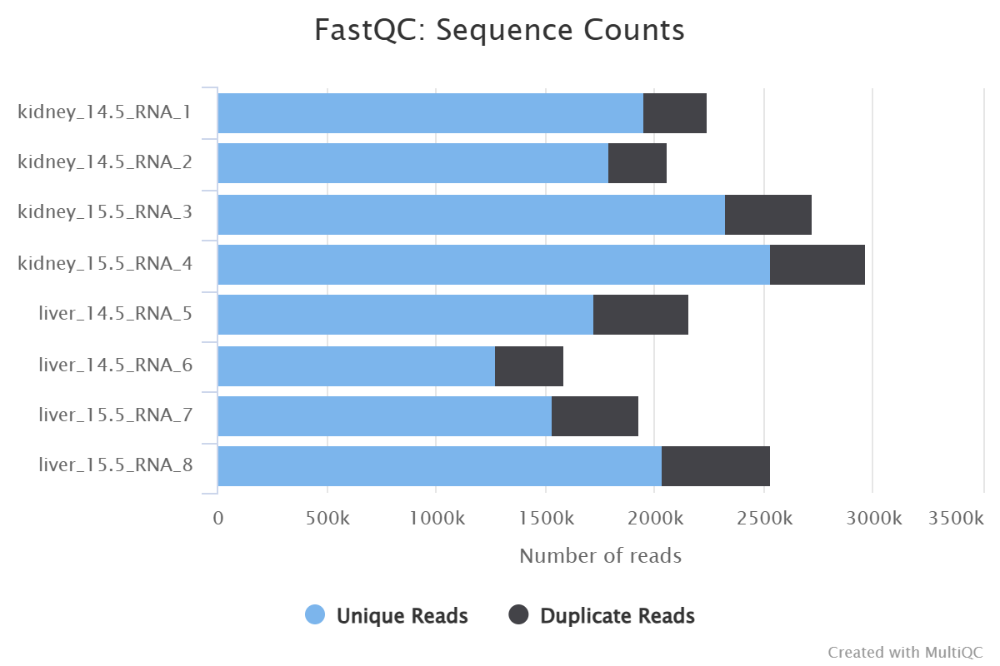
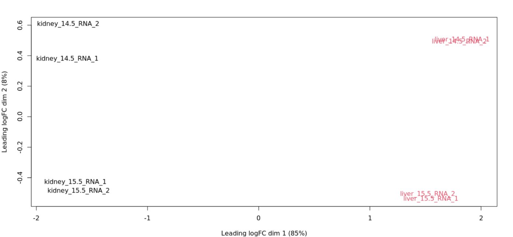
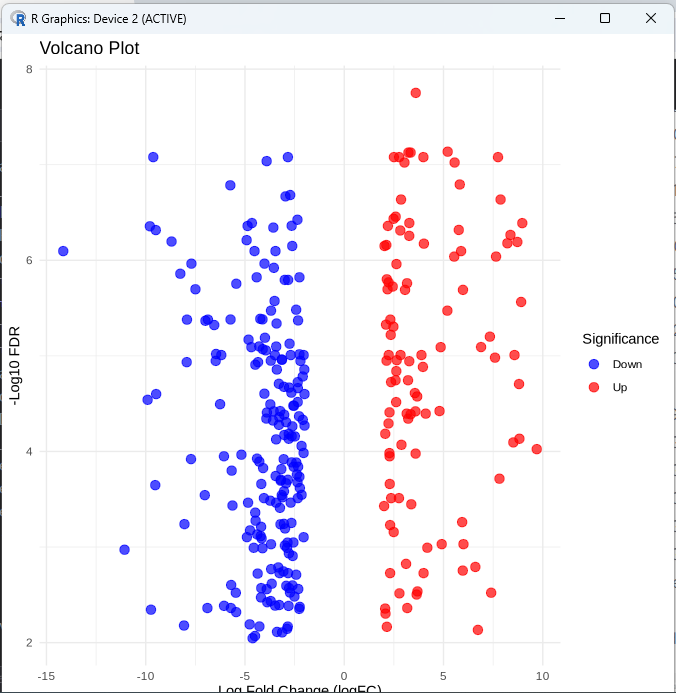
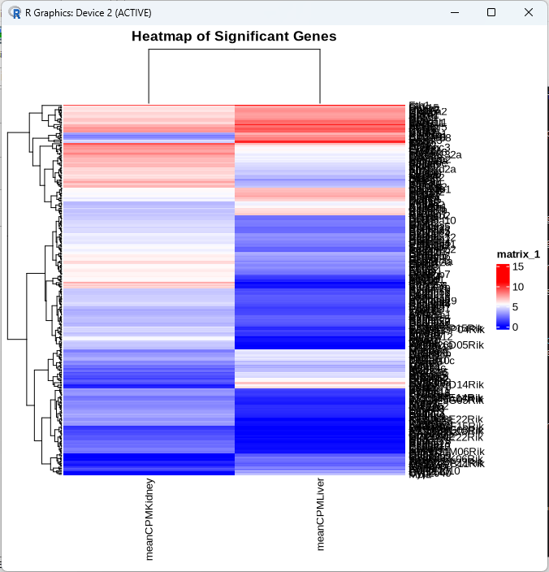
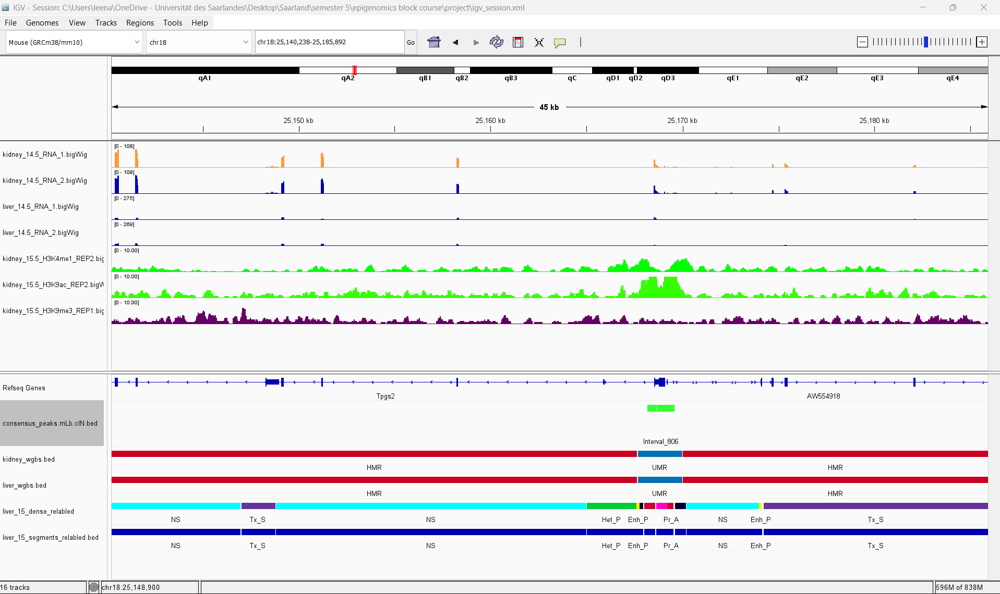

# RNA-seq and integrative epigenomics | mouse kidney and liver

**Course project — Computational Methods for Epigenome Analysis, Saarland University**  
**Contributors:** Leen Ajjan Alhadid and Dua Shahid

## Overview

This project analyzed gene expression in **eight mouse embryonic kidney and liver RNA-seq samples** (E14.5 and E15.5; two replicates per tissue/stage combination). We used an existing RNA-seq workflow for preprocessing and gene quantification, performed differential expression analysis, and explored the relationship between **RNA expression, DNA methylation, and chromatin states** using supplied epigenomic tracks.

**Repository purpose:** This is a portfolio of the completed course analysis, **not a runnable end-to-end pipeline**. The original teaching-cluster inputs and complete scripts are unavailable; portions of the original Bash/R commands survive in course notes.

## Analysis overview

```text
RNA-seq FASTQ (8 samples)
   └─ nf-core/rnaseq v3.14.0 (Nextflow, Singularity)
       ├─ FastQC / MultiQC → quality assessment
       └─ STAR + RSEM → alignment and gene-level quantification
           └─ tximport + edgeR (R)
               ├─ low-count filtering + TMM normalization
               ├─ MDS / exploratory analysis
               └─ quasi-likelihood differential expression (kidney vs liver)
                   └─ FDR, biomaRt annotation, DEG visualizations

Supplied WGBS methylation + ChIP-seq / ChromHMM state tracks
   └─ BEDTools overlaps / group summaries + IGV
       └─ exploratory examination of regulatory context
```

## Selected results

These images are **cropped directly from our original project presentation** and demonstrate the analyses carried out; they have not been reconstructed from raw data.

### Quality control

*Read counts across the eight kidney and liver libraries; original MultiQC-associated figure (presentation slide 6).*

### Sample exploration

*MDS plot of RNA-seq expression data (presentation slide 14).*

### Differential expression

*Plot of **pre-filtered significant genes**, not a conventional volcano plot containing every tested gene (presentation slide 17).*


*Expression heatmap of significant genes summarized by kidney and liver mean CPM (presentation slide 18).*

### Exploratory epigenomic interpretation

*Genome-browser examination of expression tracks, histone marks, methylation segmentation and chromatin states (presentation slide 21).*

## Methods and software

| Stage | Tools / methods |
|---|---|
| Computation | Linux, Bash, HPC/SLURM, Conda, Singularity, Nextflow |
| RNA-seq processing | **nf-core/rnaseq v3.14.0**, **STAR + RSEM**, FastQC, MultiQC |
| Differential expression | R, tximport, **edgeR**, low-abundance filtering, **TMM**, quasi-likelihood GLM testing, FDR |
| Annotation / visualization | biomaRt, MDS, heatmap, gene-level plots, IGV |
| Exploratory epigenomics | supplied **WGBS** and **ChIP-seq / ChromHMM** data, BEDTools overlaps and summaries |

## Interpretation and limitations

- The differential-expression work compared **kidney vs liver**. The documented edgeR model used a **tissue-group effect**; it did **not** explicitly adjust for developmental stage.
- The course used a **limited set of samples** and preselected genomic data for parts of the analysis. Findings should be interpreted as **educational/exploratory** rather than a comprehensive genome-wide discovery study.
- **WGBS and ChIP-seq were not processed from raw sequencing reads** in this project; preprocessed tracks/annotations were explored and compared.
- **nf-core/rnaseq was run, not developed by the students**. There is no claim of a new pipeline or a production-ready workflow.
- Only selected presentation figures are uploaded here. The full computational environment, raw data, and original end-to-end scripts are not included.

## Background and attribution

This was a **collaborative course project** at Saarland University. The figures come from the original group presentation. Please cite the original projects/tools used, including [nf-core/rnaseq](https://nf-co.re/rnaseq), [edgeR](https://bioconductor.org/packages/edgeR/), [MultiQC](https://multiqc.info/) and [BEDTools](https://bedtools.readthedocs.io/).
